# 二值神经网络卷积形式调研报告

日期：2026-11-24

## 摘要

本报告按“权重和激活分别被二值化成什么值”，把二值神经网络（BNN）的卷积归纳为 5 种形式，并基于 10 篇论文逐一分析其数学原理、训练方法、硬件实现和实验结果。主要结论如下：

- **形式 2（全 ±1，XNOR + popcount）是算法主流**，但单次二值卷积在 ImageNet 上掉点明显：AlexNet Top-1 从 56.6% 降到 44.2%（XNOR-Net）。
- **形式 3（{0,1} 激活 × ±1 权重）最适合存内计算**：激活为 0 时直接关断字线，1 位灵敏放大器替代 ADC。RRAM 全并行阵列达到 137.35 TOPS/W，约为逐行读出的 20 倍。
- **形式 4（全 {0,1}）硬件最省，并带来稀疏性**：平均 75.8% 的权重为 0，可以跳过；FPGA 上达到 1624 GOPS/W。但目前只有 MNIST 上的证据。
- **形式 5（多比特拆成二值）是换回精度的通用办法**：ABC-Net 用 5×5 个二值基，把 ResNet-18 的 Top-1 提到 65.0%（全精度 69.3%），代价是每层 25 次二值卷积。
- **建议**：面向存内计算的设计优先采用形式 3；需要 ImageNet 级精度时，在其上叠加形式 5，并优先给激活增加位宽。

## 一、背景与调研范围

**背景**：BNN 把权重和激活压到 1 位，存储降到 32 位浮点的 1/32，乘累加可以换成位运算。但“二值”在不同论文和硬件中取值不同（±1 还是 0/1），由此得到的卷积运算、硬件电路和精度表现差别很大，需要统一梳理。

**调研目标**：

1. 按二值化对象和取值，对 BNN 卷积分类。
2. 说明每一类的计算公式、训练方法和硬件映射。
3. 比较各类的精度与硬件开销，给出存内计算场景下的编码选择建议。

**资料来源**：10 篇论文（见第十节），覆盖算法（BinaryConnect、BNN、XNOR-Net、DoReFa-Net、ABC-Net）、存内计算电路（RRAM、XNOR-SRAM）和 FPGA 加速器（FINN-R、Gao 2021、Xian 2020）。文中数字均取自原文；跨论文的数字因网络、数据集和平台不同，只做定性比较。

## 二、分类框架

二值卷积按“谁被二值化、取什么值”可以分成 5 种形式。决定硬件上用哪种门电路（加减器、XNOR、AND）的，是权重 W 和激活 A 的取值集合；乘累加（MAC）也因此被替换成不同的位运算。

| 形式 | 权重 W | 激活 A | 卷积内核运算 | 典型载体 | 代表论文 |
| --- | --- | --- | --- | --- | --- |
| 1 仅二值化权重 | {−1, +1} | 实数 / 多比特 | 加减累加，无乘法 | GPU / 专用加速器 | BinaryConnect、BWN |
| 2 全 ±1 | {−1, +1} | {−1, +1} | XNOR + popcount | GPU 位运算核、FPGA、XNOR-SRAM | BNN、XNOR-Net |
| 3 混合编码 | {−1, +1} | {0, 1} | 只有激活为 1 的行参与累加，再做偏移修正 | RRAM / SRAM 存内计算阵列 | Sun et al. 2018 |
| 4 全 {0,1} | {0, 1} | {0, 1} | AND + popcount | FPGA | Xian et al. 2020 |
| 5 多比特拆二值 | 多个二值基 / 位平面 | 多个二值基 / 位平面 | 多次二值卷积后移位或加权求和 | GPU / FPGA / 位串行存内计算 | DoReFa-Net、ABC-Net |

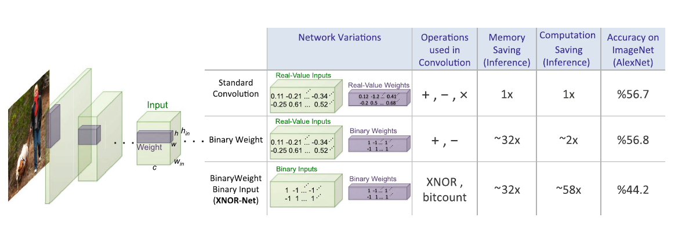

*图源：XNOR-Net 图 1。标准卷积、仅二值化权重（形式 1，BWN）、权重和输入都二值化（形式 2，XNOR-Net）三者的卷积运算、存储节省、计算节省和 AlexNet ImageNet 精度。*

阅读顺序建议：先看形式 1 和 2，理解“乘法怎样消失”；再看形式 3 和 4，理解 0/1 编码在硬件上的好处和代价；最后看形式 5，理解怎样用多次二值运算换回精度。

## 三、形式 1：仅二值化权重（BinaryConnect / BWN）

只把权重约束为 ±1，激活保持实数，乘累加就退化成“按权重符号做加法或减法”。在 ImageNet 上，带缩放因子的 BWN 版 AlexNet 的 Top-1 为 56.8%，全精度 AlexNet 为 56.6%，精度几乎没有损失。

### 卷积怎样变成加减法

一个输出神经元的值是 n 个输入与权重乘积的和。权重只取 ±1 时，x·(+1) = x，x·(−1) = −x，所以乘法器可以去掉，只保留一个由权重符号控制加减的累加器：

```math
y = \sum_{i=1}^{n} x_i w_i^b = \sum_{i:\,w_i^b=+1} x_i \; - \sum_{i:\,w_i^b=-1} x_i
```

BinaryConnect 给出的硬件理由是：乘法器是数字神经网络实现中最占面积、最耗电的部件，定点加法器的面积和能耗都远低于定点乘累加器。

### 二值化函数

BinaryConnect 提供两种二值化：

- **确定性**：w ≥ 0 取 +1，否则取 −1，即 sign 函数。
- **随机性**：以概率 p = σ(w) 取 +1，其中 σ 是 hard sigmoid：

```math
\sigma(x) = \mathrm{clip}\left(\frac{x+1}{2},\,0,\,1\right)
```

随机版本的期望等于原实数权重，量化误差在众多权重之间大致相互抵消，效果类似 DropConnect 这类权重噪声正则化。

### 训练：传播用二值，更新用实数

这是所有 BNN 训练的共同基础，后面的形式都沿用。

1. 前向传播：用二值权重 w_b = binarize(w) 计算各层激活。
2. 反向传播：仍用 w_b 计算对激活的梯度。
3. 参数更新：把梯度累加到**实数权重** w 上，再把 w 裁剪到 [−1, 1]。

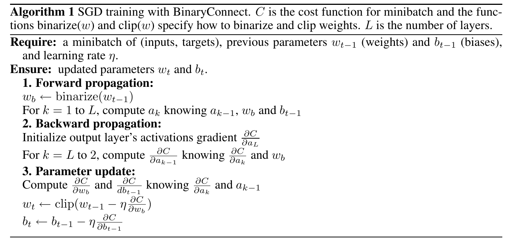

*图源：BinaryConnect Algorithm 1。上面三步就是这里的 1. Forward / 2. Backward / 3. Parameter update：前向和反向只用 w_b，更新写回实数权重 w_t = clip(w_{t−1} − η·∂C/∂w_b)。*

必须保留实数权重的原因：SGD 每步的参数变化极小，直接在二值权重上更新会把这些小变化全部舍入掉。裁剪到 [−1, 1] 则是因为 |w| 超过 1 后不再影响二值结果，不裁剪会无限增大。推理时只需保存 w_b。

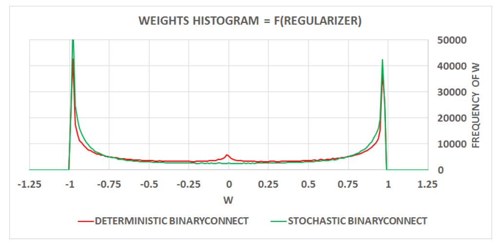

*图源：BinaryConnect 图 2，MNIST MLP 第一层的实数权重直方图。裁剪使全部权重都落在 [−1, 1] 内，并堆积在 ±1 附近，说明权重在向确定的二值收敛。确定性版本（红线）在 0 附近有一小峰，是在 −1 和 +1 之间来回摇摆的权重。*

### BWN：加上缩放因子 α

XNOR-Net 论文中的 Binary-Weight-Network（BWN）把每个卷积核近似为 W ≈ αB，B ∈ {+1, −1}^n，α > 0，n = c×w×h。求解最小化 ‖W − αB‖² 得到解析解：

```math
B^* = \mathrm{sign}(W), \qquad \alpha^* = \frac{W^{\top}\mathrm{sign}(W)}{n} = \frac{1}{n}\lVert W \rVert_{\ell 1}
```

即最优二值核就是权重的符号，最优缩放因子是权重绝对值的均值。卷积变为：

```math
I * W \approx (I \oplus B)\,\alpha
```

其中 ⊕ 表示只用加减法的卷积。每个输出通道只多一次标量乘法，而且可以并入后面的 BN。

### 实验结果

| 模型 / 数据集 | 方法 | 结果 |
| --- | --- | --- |
| CNN / CIFAR-10（无数据增强） | 无正则化全精度 | 错误率 10.64% |
| CNN / CIFAR-10 | BinaryConnect（确定性） | 错误率 9.90% |
| CNN / CIFAR-10 | BinaryConnect（随机性） | 错误率 8.27% |
| AlexNet / ImageNet | 全精度 | Top-1 56.6% |
| AlexNet / ImageNet | BinaryConnect | Top-1 35.4% |
| AlexNet / ImageNet | BWN（加 α） | Top-1 56.8% |

两个结论：在小数据集上，二值权重甚至起到正则化作用；在 ImageNet 上，没有缩放因子会掉点严重，α 是把形式 1 推广到大数据集的关键。XNOR-Net 报告 BWN 的存储约为单精度的 1/32，由于去掉了乘法，卷积约快 2 倍。

**硬件含义**：激活仍是多比特，所以数据通路和累加器位宽没有缩小，省下的主要是权重存储和乘法器。在存内计算中，这对应“多比特输入 × 1 位权重”的阵列，输入要用多级电压或位串行方式送入。

## 四、形式 2：权重和激活全 ±1（BNN / XNOR-Net）

权重和激活都取 ±1 时，一次乘累加等价于一次 XNOR 加一次 popcount（数 1 的个数），存储和访存都降到 32 位浮点的 1/32。代价是精度：ImageNet 上 AlexNet 的 Top-1 从全精度 56.6% 降到 XNOR-Net 的 44.2%。

### XNOR-popcount 的推导

硬件里用 1 个比特存 ±1：+1 存为 1，−1 存为 0。两个 ±1 相乘的结果和它们编码的 XNOR 一一对应：

| a | w | a·w | a 编码 | w 编码 | XNOR |
| --- | --- | --- | --- | --- | --- |
| +1 | +1 | +1 | 1 | 1 | 1 |
| +1 | −1 | −1 | 1 | 0 | 0 |
| −1 | +1 | −1 | 0 | 1 | 0 |
| −1 | −1 | +1 | 0 | 0 | 1 |

设长度为 N 的向量中有 P 个位置 XNOR = 1（乘积为 +1），其余 N − P 个位置乘积为 −1，则：

```math
\mathbf{a}\cdot\mathbf{w} = P - (N - P) = 2\,\mathrm{popcount}\big(\mathrm{XNOR}(\mathbf{a}_b,\mathbf{w}_b)\big) - N
```

N 是常数，所以卷积只需要逐位 XNOR 和一次计数。BNN 在 GPU 上把 32 个二值变量拼成一个 32 位寄存器（SWAR），用 3 条指令完成 32 个连接的计算：

```math
a_1 \mathrel{+}= \mathrm{popcount}\big(\mathrm{xnor}(a_0^{32b},\,w_1^{32b})\big)
```

### 训练：直通估计器（STE）

sign 函数几乎处处导数为 0，梯度无法反传。BNN 用带饱和的 STE：设 q = Sign(r)，则

```math
g_r = g_q \cdot \mathbf{1}_{|r|\le 1}
```

等价于把梯度通过 Htanh(x) = Clip(x, −1, 1) 反传。论文指出，|r| 过大时不把梯度置 0 会明显变差。权重方面沿用形式 1 的做法：保留实数权重、裁剪到 [−1, 1]、前向时取 Sign。

### XNOR-Net：给激活也加缩放因子

XNOR-Net 在 BWN 的 α 基础上，为激活也引入缩放因子 β：XᵀW ≈ βHᵀαB，最优解为 H* = sign(X)、β* = ‖X‖₁/n。卷积时每个滑窗位置的 β 不同，逐窗计算会大量重复，所以：

1. 先沿通道求输入绝对值的平均，得到矩阵 A。
2. 用全为 1/(w×h) 的 2D 核 k 卷积 A，得到 K = A ∗ k，K_ij 就是以 (i, j) 为中心的滑窗的 β。
3. 最终卷积为：

```math
I * W \approx \big(\mathrm{sign}(I) \circledast \mathrm{sign}(W)\big) \odot K\alpha
```

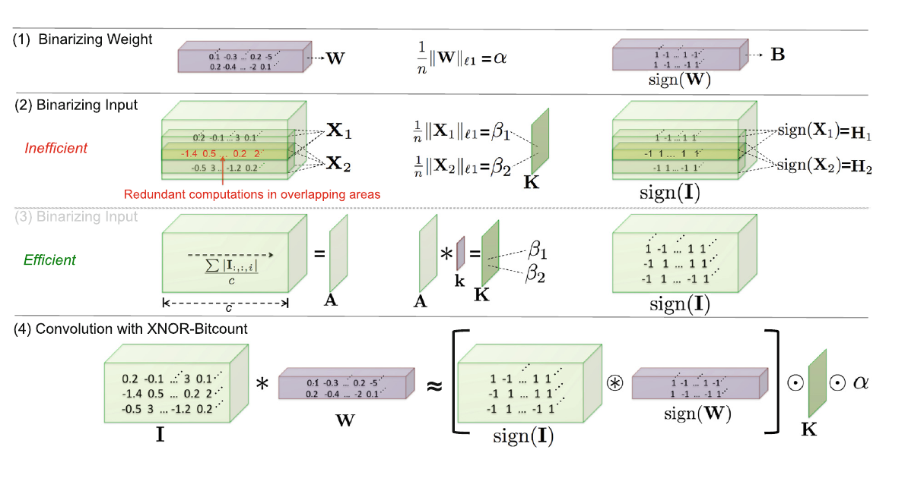

*图源：XNOR-Net 图 2。(1) 权重二值化得到 α 和 sign(W)；(2) 逐窗计算 β 存在重叠区域的重复计算；(3) 先求通道均值 A，再用 k 卷积得到 K；(4) sign(I) 与 sign(W) 做 XNOR-bitcount 卷积，再乘 K 和 α。*

其中 ⊛ 表示用 XNOR 和 bitcount 实现的卷积。XNOR-Net 还调整了层顺序：BN → BinActiv → BinConv → Pool。先 BN 是为了让输入零均值，减小以 0 为阈值的量化误差；把 Pool 放在卷积后，是因为对二值输入做 max-pooling 会得到几乎全为 +1 的张量。

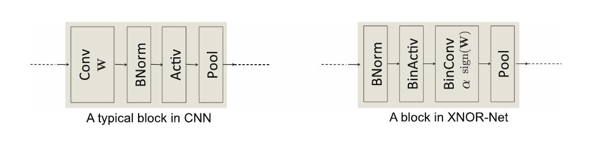

*图源：XNOR-Net 图 3。左：普通 CNN 块 Conv → BNorm → Activ → Pool；右：XNOR-Net 块 BNorm → BinActiv → BinConv → Pool。*

### 第一层怎么办

网络输入是 8 位像素，不是 ±1。BNN 把输入拆成 8 个位平面，分别与二值权重做二值点积后再移位相加：

```math
s = \mathbf{x}\cdot\mathbf{w}_b = \sum_{n=1}^{8} 2^{n-1}\,(\mathbf{x}^{n}\cdot\mathbf{w}_b)
```

这已经是形式 5（位平面分解）的雏形。

### 实验结果与硬件收益

| 模型 / 数据集 | 方法 | 结果 |
| --- | --- | --- |
| ConvNet / CIFAR-10 | BNN（Torch7） | 错误率 10.15% |
| ConvNet / CIFAR-10 | 全精度（无正则化） | 错误率 10.94% |
| AlexNet / ImageNet | BNN（XNOR-Net 论文复现） | Top-1 27.9% |
| AlexNet / ImageNet | XNOR-Net（加 α 和 K） | Top-1 44.2% |
| AlexNet / ImageNet | 全精度 | Top-1 56.6% |

BNN 论文自己报告的 AlexNet 初步结果是 Top-1 36.1%，与 XNOR-Net 表中的 27.9% 不同，差异来自两篇论文的实现和训练设置。

硬件收益（均来自原论文）：

- 32 位浮点乘法器约占 200 个 Xilinx FPGA slice，1 位 XNOR 门只占 1 个。
- GTX750 上 8192³ 二值矩阵乘法，XNOR 核比未优化的基线核快 23 倍；MNIST BNN 运行快 7 倍且不掉点。
- XNOR-Net 在 CPU 上单次卷积的高精度运算数减少约 58 倍。
- 3×3 二值核最多只有 2⁹ = 512 种，CIFAR-10 模型每层平均只有 42% 的核是不重复的，可以复用结果进一步减少运算。

## 五、形式 3：{0,1} 激活 × ±1 权重（存内计算中的混合编码）

激活改用 {1, 0}、权重保持 {+1, −1}，是为了让存内计算阵列可以直接用“开不开字线”来表示输入：激活为 0 的行不开启，不贡献任何电流。Sun 等（ASP-DAC 2018）据此设计的全并行 RRAM 阵列达到 137.35 TOPS/W，是逐行读出方案的约 20 倍。

### 公式

设 a_i ∈ {0, 1}，w_i ∈ {+1, −1}。只有 a_i = 1 的项参与累加：

```math
\mathbf{a}\cdot\mathbf{w} = \sum_{i:\,a_i=1} w_i = \#\{a_i=1,\,w_i=+1\} - \#\{a_i=1,\,w_i=-1\}
```

数字实现时，把权重编码为 w_b（+1 →1，−1 → 0），得到：

```math
\mathbf{a}\cdot\mathbf{w} = 2\,\mathrm{popcount}(\mathbf{a}\ \mathrm{AND}\ \mathbf{w}_b) - \mathrm{popcount}(\mathbf{a})
```

第二项 popcount(a) 是当前输入中 1 的个数，就是“偏移修正”。它和形式 2 的关系：若 a' = 2a − 1 ∈ {±1}，则 a'·w = 2(a·w) − Σw，两者只差一个仿射变换。但激活函数从 sign 变成了阶跃函数（正则输出 1，负则输出 0），所以网络需要按这种编码训练或截断，不能直接沿用 ±1 网络的参数。

### 在 RRAM 阵列上怎样实现（Sun et al. 2018）

1. **权重用一对互补单元存**：+1 = (LRS, HRS)，−1 = (HRS, LRS)，左单元接 SL，右单元接 SL_bar。仿真中 LRS 为 200 kΩ，HRS 为 200 MΩ。
2. **输入控制字线**：输入为 1 时开启该行 WL，输入为 0 时选通管关闭，该行对 SL 和 SL_bar 都没有电流。
3. **所有行同时开启**：LRS 电流占主导，所以 I_SL − I_SL_bar 正比于“开启行中 +1 的个数 − −1 的个数”，正好等于上式的加权和。
4. **用 1 位电流型灵敏放大器（CSA）代替 ADC**：比较 I_SL 和 I_SL_bar，和为正输出 1，为负输出 0。这个输出直接就是下一层的 {1, 0} 激活，不需要加法器、寄存器和比较器。

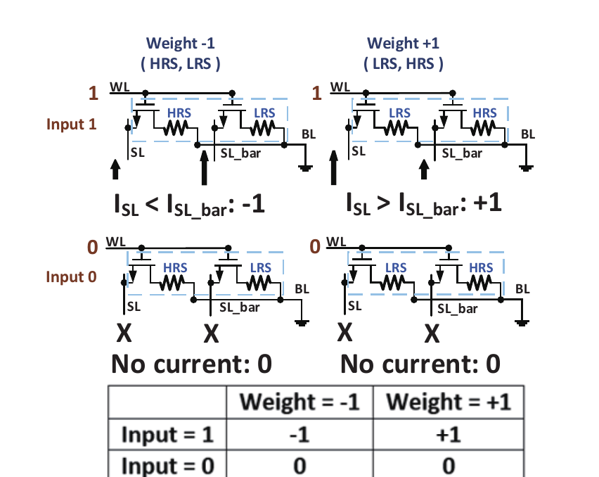

*图源：Sun et al. 2018 图 4。权重 −1 = (HRS, LRS)，+1 = (LRS, HRS)。输入为 1 时字线开启，通过比较 I_SL 和 I_SL_bar 得到 ±1；输入为 0 时无电流。下方真值表就是形式 3 的乘法表。*

若激活仍用 ±1，输入 −1 的行也必须开启并把权重极性反转，字线驱动和单元结构都会更复杂。这就是 Sun 等把神经元改为 (+1, 0) 的原因。

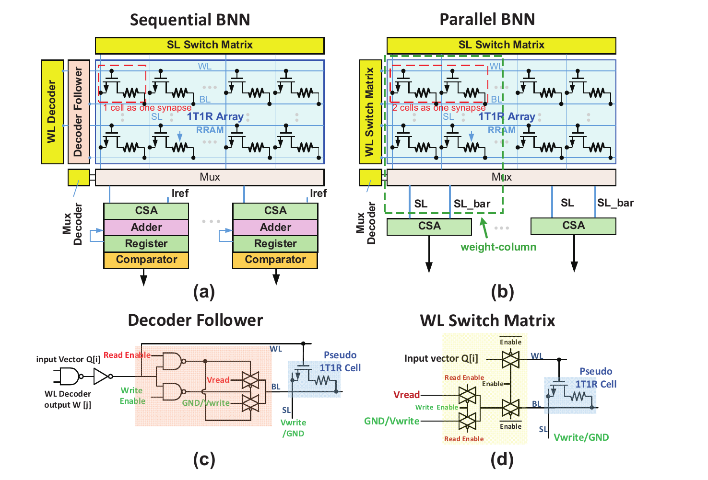

*图源：Sun et al. 2018 图 3。(a) 逐行读出的 S-BNN：1 个单元存 1 个权重，列末需要 CSA、加法器、寄存器和比较器；(b) 全并行的 P-BNN：2 个单元存 1 个权重，SL/SL_bar 差分接入 1 个 CSA 即得输出；(c)(d) 对应的字线驱动电路。*

### 结果（MNIST，类 LeNet，评估 64-64-10 全连接层，TSMC 65 nm）

| 指标 | S-BNN（逐行读出） | P-BNN（全并行） |
| --- | --- | --- |
| 推理精度 | 约 98.5% | 平均约 97.6%（含 CSA 失调，1000 次蒙特卡洛，标准差约 0.6%） |
| 单次访问时间 | 5 ns | 1 ns |
| 能效 | 约 1/20 | 137.35 TOPS/W |
| 芯片面积 | 基准 | 约 −16%（省去列末 MAC 外围电路） |

算法层面，浮点训练后把权重和神经元截断到 1 位，推理精度为 98.54%，只损失约 0.2%。代价是 CSA 的工艺失调：当 SL 与 SL_bar 的 LRS 单元数之差很小时会判错，仿真显示差值大于 5 时判对率接近 100%。

### 对照：XNOR-SRAM 用的是形式 2

XNOR-SRAM（Yin et al., JSSC 2020）支持 ±1 权重配 ±1 输入，也支持 ±1 权重配三值输入 {+1, 0, −1}。每个输入按编码驱动 4 条读字线；每个位单元的 XNOR 结果在读位线上形成上拉或下拉通路，256 行同时开启，构成电阻分压，再由 11 级 flash ADC 读出。

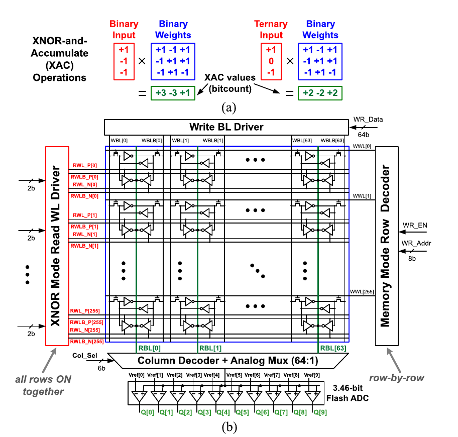

*图源：Yin et al. 2020 图 1。(a) 二值输入与三值输入分别和二值权重做 XNOR 累加（XAC），三值输入中的 0 不贡献累加；(b) 256×64 阵列，XNOR 模式下所有行同时开启，读位线电压由 3.46 位 flash ADC 读出。*

| 对比项 | Sun 2018 P-BNN（形式 3） | XNOR-SRAM（形式 2 / 三值） |
| --- | --- | --- |
| 存储器件 | RRAM 1T1R，两单元存一个权重 | SRAM，位单元内嵌 XNOR 电路 |
| 输入编码 | {1, 0}，0 = 字线关闭 | ±1 或 {+1, 0, −1}，每个输入驱动 4 条 RWL |
| 读出电路 | 1 位 CSA，直接输出下一层激活 | 11 级 flash ADC，输出多位部分和 |
| 工艺 | TSMC 65 nm（仿真） | 65 nm CMOS（流片） |
| 能效 | 137.35 TOPS/W | 403 TOPS/W（三值 XAC，0.6 V） |
| 精度 | MNIST 约 97.6% | CIFAR-10 87.3%（二值）/ 88.8%（三值） |

两者的能效数字来自不同器件、不同任务和不同评估方式（仿真与流片），只能定性对比。值得注意的是，XNOR-SRAM 的三值输入里的 0 和形式 3 的 0 作用相同：都表示“这一行不贡献累加”。

## 六、形式 4：权重和激活全 {0,1}

权重和激活都取 {0, 1} 时，乘法就是 AND，卷积只剩 AND + popcount，是硬件上最简单的一种。代价是权重不再有负值，网络必须按这种编码重新训练，目前的证据主要在 MNIST 一类小任务上。

**来源**：Xian, Li, Li，Weight Isolation-Based Binarized Neural Networks Accelerator，ISCAS 2020（已与原文核对）。Gao 2021 自己用的是 XNOR-Net（±1），这里只作对照。

### 公式

```math
\mathbf{a}\cdot\mathbf{w} = \sum_{i=1}^{N} a_i w_i = \mathrm{popcount}(\mathbf{a}\ \mathrm{AND}\ \mathbf{w}), \qquad a_i, w_i \in \{0,1\}
```

没有偏移修正项，也没有符号。若把它与 ±1 网络对应起来（a' = 2a − 1，w' = 2w − 1），会得到：

```math
\mathbf{a}'\cdot\mathbf{w}' = 4\,(\mathbf{a}\cdot\mathbf{w}) - 2\sum_i a_i - 2\sum_i w_i + N
```

其中 Σa_i 随输入变化，所以全 {0,1} 不是 ±1 网络的简单换码，而是另一类函数。权重 0 表示“没有连接”，只有兴奋、没有抑制；抑制作用只能靠后面由 BN 折算出的阈值来提供，网络必须按这种编码重新训练（这一点是我们的分析）。不过 Xian 2020 在 MNIST 上的对比显示，两种编码的精度和收敛速度基本相同；在更大的数据集上是否仍然如此，目前没有证据。

### 为什么硬件喜欢 {0,1} 权重：FINN-R 的测量

FINN-R（Blott et al., TRETS 2018）在 FPGA 上测量了点积单元的 LUT 成本：

- 从普通 1 位整数权重 {0, 1} 换成二值权重 {−1, 1}，成本增加最多。原因是要计算激活的负倍数，必须多分配一个符号位。
- 只有激活也是 1 位、采用 XNOR-Net 或 FINN 那样的 XNOR 做法时，这部分开销才能消掉；否则 LUT 成本增加 35%。
- 再到三值或 2 位，每一步另增约 20%。

FINN 还把 BN 和 sign 合并成一次阈值比较（streamlining）：popcount 结果直接和每个通道的整数阈值比大小，就得到下一层的 1 位激活。这一步对形式 2、3、4 都适用，偏移修正项也可以一并折进阈值。

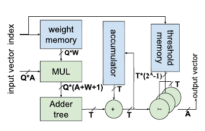

*图源：FINN-R 图 6。一个 PE 并行做 Q 个乘法，经加法树和累加器得到点积，再与阈值存储器中的阈值比较（≥）得到输出激活。BN 和二值化就折算在这些阈值里。*

### Xian 2020 的做法

**动机**：用 1 个比特存 ±1 时，硬件还要做额外运算。隐藏层 popcount 之后要算 R = 2 × S_pop − V_vec_len（左移和减法）；第一层输入是 8 位图像，权重为 −1 时还要做减法。权重和激活都改成 {0,1} 后，这些运算都省掉了。

**二值化函数与训练**：权重和激活都用下面的函数。训练沿用 BNN 的做法：保留高精度权重，反向传播时用 Htanh 的梯度（即 STE）。

```math
\mathrm{Binarized}(x) = \begin{cases} 1, & x \ge 0 \\ 0, & x < 0 \end{cases}
```

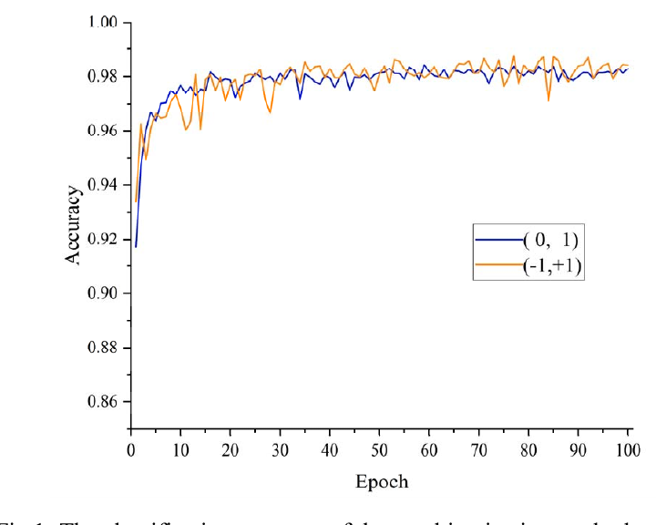

*图源：Xian 2020 图 1。同一个 MNIST 模型（2 个卷积层、2 个池化层、2 个归一化层、3 个全连接层）分别用 {0, 1} 和 {−1, +1} 训练 100 轮。两者精度都在约 0.98，{0, 1} 的曲线波动更小。*

**处理单元**：一个 PE 一次处理 8 位输入，配 8 个 AND 门；每个 AND 门后接 popcount 求部分和，加法器得到卷积结果，再由比较器一次完成 BN 和二值化。AND 门和加法器之后插入寄存器切分关键路径（retiming），使设计能跑到 500 MHz。整个加速器由 18 个 10×10 的 PE 阵列组成，没有使用任何 DSP。

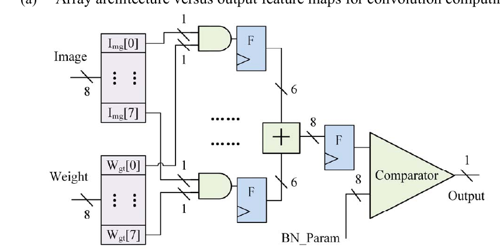

*图源：Xian 2020 图 2(b)。图像位和权重位逐位相与，经寄存器后求和，最后与 BN_Param 比较，输出 1 位激活。这就是形式 4 的 AND + popcount + 阈值比较。*

**0 权重带来的稀疏性**：在 {0,1} 编码下，只要权重为 0，乘积就一定为 0，对应的输入数据根本不需要送进 PE。Xian 据此设计了权重隔离逻辑：权重为 1 时才放行图像数据，以降低信号翻转率和功耗。这是 ±1 编码没有的好处，因为 ±1 的每一项都对结果有贡献。各层 0 权重的比例如下（Xian 2020 表 I）：

| 层 | Conv1 | Conv2 | FC1 | FC2 | FC3 | 平均 |
| --- | --- | --- | --- | --- | --- | --- |
| 0 权重比例 | 79.3% | 81.1% | 79.9% | 81.2% | 57.3% | 75.8% |

**数据复用**：相邻 PE 的卷积窗口大量重叠。在 10×10 PE 阵列、14×14 特征图、5×5 卷积核的配置下，通过拼接相邻 PE 已读入的数据，片外读取从 2500 位降到 1030 位，减少 58.8%。

### FPGA 实现数据（MNIST）

| 设计 | 编码 | 平台 | 频率 | 吞吐 | 功耗 | 能效 |
| --- | --- | --- | --- | --- | --- | --- |
| Xian 2020 | 全 {0,1}，AND + popcount | Virtex-7 XC7VX690T（VC709） | 500 MHz | 3378 GOPS | 2.08 W | 1624 GOPS/W |
| Gao 2021 | ±1（XNOR-Net）加剪枝 | Zynq-7000 XC7Z100 | 450 MHz | 6921.97 GOPS | — | 4019.73 GOPS/W |
| FINN 2017 | ±1，XNOR + popcount | Zynq | — | — | — | 1033 GOPS/W |

Xian 2020 和 FINN 2017 的数字来自 Xian 2020 原文，Gao 2021 的数字来自其表 1。Xian 原文正文没有给出精确精度，图 1 曲线约为 0.98；Gao 2021 表 1 记为 98.2%。Gao 2021 对 Xian 的评价是“需要重新训练、只在 MNIST 上评估”，与原文一致。Gao 2021 自己是在 ±1 网络上剪掉 57% 的运算（LeNet）和 51% 的运算（CIFAR-10 VGG-like），精度不变。各行平台不同，而且 Gao 的增益主要来自剪枝而非编码，不能据此判断哪种编码更优。

如果要继续深入形式 4，可以补读 FINN-R 提到的 Kim & Smaragdis，Bitwise Neural Networks（全二值全连接网络，一部分突触权重预先置 0，MNIST 98.7%）。

## 七、形式 5：多比特拆成多次二值卷积（DoReFa-Net / ABC-Net）

把多比特的权重或激活拆成若干个二值分量，每对分量做一次二值卷积，再加权求和。这样底层仍然只用形式 2–4 的位运算，精度却可以调节。ABC-Net 用 5 个权重基和 5 个激活基，把 ResNet-18 的 Top-1 从 XNOR-Net 的 51.2% 提到 65.0%（全精度 69.3%），代价是每层要做 25 次二值卷积。

拆分有两种思路，区别在于“基”和“系数”是固定的还是学出来的。

### 5a：位平面分解（DoReFa-Net，bit-serial）

x 是 M 位定点数向量，y 是 K 位定点数向量，c_m(x) 和 c_k(y) 是它们的第 m、k 个位平面（{0,1} 向量）：

```math
\mathbf{x}\cdot\mathbf{y} = \sum_{m=0}^{M-1}\sum_{k=0}^{K-1} 2^{m+k}\,\mathrm{bitcount}\big[\mathrm{and}(c_m(\mathbf{x}),\,c_k(\mathbf{y}))\big]
```

- 底层就是形式 4 的 AND + bitcount，系数固定为 2 的幂，只需移位。
- 计算量是 O(M·K)，与两边位宽之积成正比。
- 这就是存内计算里常见的“输入位串行、权重分列存放、列末移位累加”。BNN 第一层处理 8 位像素用的也是这个办法（见形式 2）。

DoReFa-Net 的量化方式：

- **激活**：先经过有界激活函数落到 [0, 1]，再量化为 k 位。所以 1 位激活取 {0, 1}；配上 ±1 二值权重时，算法上正好就是形式 3 的编码。
- **权重**：1 位时用 sign(r) × E(|r|)，全层共用一个常数缩放。不用 XNOR-Net 的逐通道 α，是为了反向传播时也能用位卷积。
- **梯度**：用随机量化压到低位宽，反向传播也能用位卷积，这是 DoReFa 的主要创新。
- **第一层和最后一层**不量化。

**公式提醒**：DoReFa 脚注里 ±1 向量的公式写成 x·y = N − 2×bitcount(xnor(x, y))。按形式 2 的推导，正确的写法应是 2·popcount(XNOR) − N，或等价的 N − 2·popcount(XOR)。

### 5b：多个二值基的线性组合（ABC-Net）

ABC-Net 用 M 个 ±1 权重基和 N 个 ±1 激活基近似实数卷积：

```math
\mathrm{Conv}(W, R) \approx \sum_{m=1}^{M}\sum_{n=1}^{N} \alpha_m \beta_n\,\mathrm{Conv}(B_m, A_n)
```

- **权重基**：B_i = sign(W̄ + u_i·std(W))，即把去均值后的权重按不同偏移量 u_i 各取一次符号。u_i 可以在 [−std, +std] 上均匀取值，也可以训练。基固定后，系数 α 通过线性回归求出。M = 1 时退化为 BWN。
- **激活基**：A_n = H_{v_n}(R) = 2·𝟙[clip(R + v_n, 0, 1) ≥ 0.5] − 1，即用 N 个不同阈值把同一个激活各二值化一次。偏移 v_n 和系数 β_n 都可训练，推理时固定。
- **并行性**：M×N 个二值卷积互相独立，可以同时计算。每个都是形式 2 的 XNOR + popcount。
- **层顺序**：和 XNOR-Net 一样，把 max-pooling 提到 BN 和激活之前，避免二值输入池化后几乎全为 +1。

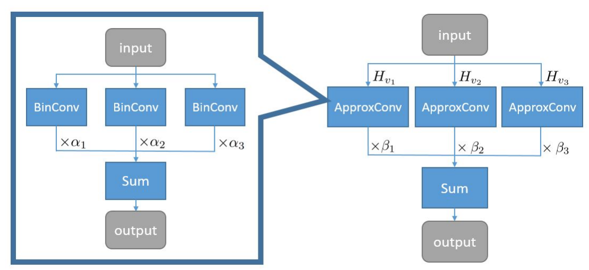

*图源：ABC-Net 图 1（M = N = 3）。左：ApproxConv 由 3 个 BinConv 分别乘 α_m 后求和；右：输入经 3 个不同阈值的 H_v 二值化，各自进入 ApproxConv，再乘 β_n 求和，共 9 个可并行的二值卷积。*

与 5a 的区别：5a 的基是位平面、系数固定为 2 的幂，是无损分解；5b 的基和系数都是学出来的，是有损近似，但同样数量的基表达能力更强。

### 实验结果（ImageNet）

ResNet-18，数据来自 ABC-Net 表 3：

| 方法 | 权重位宽 | 激活位宽 | Top-1 | Top-5 |
| --- | --- | --- | --- | --- |
| 全精度 | 32 | 32 | 69.3% | 89.2% |
| ABC-Net（M = 5，全精度激活） | 1 × 5 基 | 32 | 68.3% | 87.9% |
| ABC-Net（M = 5，N = 5） | 1 × 5 基 | 1 × 5 基 | 65.0% | 85.9% |
| BWN | 1 | 32 | 60.8% | 83.0% |
| DoReFa-Net | 1 | 4 | 59.2% | 81.5% |
| XNOR-Net | 1 | 1 | 51.2% | 73.2% |
| BNN | 1 | 1 | 42.2% | 67.1% |

AlexNet，数据来自 DoReFa-Net 表 2（梯度为 32 位）：W1A1 为 40.1%，W1A2 为 47.7%，W1A4 为 50.3%，全精度为 55.9%。结论：激活比权重更需要位宽，从 1 位到 2 位收益最大。ABC-Net 的 ResNet-18 实验也印证这一点：M = 3 时，N 从 1 增到 3，Top-1 从 49.1% 升到 61.0%。

## 八、对比结论与建议

五种形式的差别归结为一点：编码越简单，硬件越省，但对算法的约束越强。形式 2 是算法研究的主流，形式 3 是存内计算阵列最顺手的编码，形式 5 是用更多二值运算换回精度的通用办法。

| 形式 | 点积内核 | 额外修正项 | 与 ±1 网络的关系 | 文中最好的精度证据 | 存内计算适配 |
| --- | --- | --- | --- | --- | --- |
| 1 仅二值权重 | 加减累加 | 每通道 α，可并入 BN | — | AlexNet ImageNet Top-1 56.8%（BWN） | 输入需多级电压或位串行，外围需多位 ADC |
| 2 全 ±1 | XNOR + popcount | −N（常数）、α、K | 本身 | ResNet-18 ImageNet Top-1 51.2%（XNOR-Net） | 输入 −1 的行也要驱动，例如 XNOR-SRAM 每个输入用 4 条 RWL |
| 3 {0,1} × ±1 | 有效行累加 / AND + popcount | −popcount(a)（随输入变） | 仿射变换，但激活改为阶跃函数 | MNIST 97.6%（RRAM 含失调） | 最自然：0 = 关字线，差分列 + 1 位 SA |
| 4 全 {0,1} | AND + popcount | 无 | 不等价，需重新训练 | MNIST 约 98%，与 ±1 版本相当（Xian 2020） | 单端列即可，没有负权重；0 权重的行可以跳过（Xian 2020 平均 75.8% 的权重为 0） |
| 5 多比特拆二值 | M×K 或 M×N 次二值卷积 | 移位或 α·β 加权 | 底层复用形式 2–4 | ResNet-18 ImageNet Top-1 65.0%（ABC-Net 5×5） | 输入位串行 + 列末移位累加 |

各行的精度来自不同网络和数据集，只用来说明每种形式目前被验证到的规模，不能横向比较。

### 建议：存内计算中怎样选编码

1. **想用 1 位 SA 代替 ADC**：选形式 3。激活 {1, 0} 直接对应字线开关，权重 ±1 用互补单元对加差分灵敏放大器实现，SA 输出就是下一层输入（Sun 2018）。主要风险是 SA 失调。
2. **算法已按 ±1 训练好、不想重训**：用形式 2 的阵列（如 XNOR-SRAM），或用形式 3 的阵列再做偏移修正。偏移修正和 BN 都可以折进每通道的阈值（FINN 的 streamlining）。
3. **需要 ImageNet 级精度**：单次二值卷积不够，应采用形式 5。算力随基的个数或位宽成倍增加，优先给激活加位宽。
4. **形式 4** 硬件最省，但目前只有小任务证据，适合作为极低功耗场景的备选。

## 九、待解决问题与后续工作

| 问题 | 现状 | 建议的后续工作 |
| --- | --- | --- |
| 全 {0,1} 在大数据集上的精度 | 只有 MNIST 证据（Xian 2020） | 在 CIFAR-10 / ImageNet 上对比 {0,1} 与 ±1 编码 |
| 形式 3 的灵敏放大器失调 | MNIST 上平均从 98.5% 降到 97.6% | 评估带失调消除的 SA，或在训练中加入失调模型 |
| 形式 3 的偏移修正 | 理论上可以折进阈值，尚未在阵列层面验证 | 结合 FINN 的阈值合并方法做电路级验证 |
| 形式 5 的计算代价 | M×N 次二值卷积，ABC-Net 5×5 = 25 次 | 评估位串行存内计算中基的个数与能效的折中 |
| 能效数字的可比性 | 器件、工艺、任务各不相同，只能定性比较 | 在统一的网络和数据集上建立对比基准 |

## 十、参考文献

文中数字均来自上传的全文，标注为“转述”的除外。

| # | 论文 | 出处 | 本文用于 |
| --- | --- | --- | --- |
| 01 | [BinaryConnect: Training Deep Neural Networks with binary weights during propagations](https://arxiv.org/abs/1511.00363)（Courbariaux, Bengio, David） | NeurIPS 2015 | 形式 1、训练方法 |
| 02 | [Binarized Neural Networks](https://arxiv.org/abs/1602.02830)（Hubara, Courbariaux, Soudry, El-Yaniv, Bengio） | NeurIPS 2016 | 形式 2、STE |
| 03 | [XNOR-Net: ImageNet Classification Using Binary Convolutional Neural Networks](https://arxiv.org/abs/1603.05279)（Rastegari et al.） | ECCV 2016 | 形式 1（BWN）、形式 2 |
| 04 | [Fully Parallel RRAM Synaptic Array for Implementing Binary Neural Network with (+1, −1) Weights and (+1, 0) Neurons](https://www.aspdac.com/aspdac2018/archive/pdf/6C-2.pdf)（Sun, Peng, Chen, Liu, Seo, Yu） | ASP-DAC 2018 | 形式 3 |
| 05 | [XNOR-SRAM: In-Memory Computing SRAM Macro for Binary/Ternary Deep Neural Networks](https://doi.org/10.1109/JSSC.2019.2963616)（Yin, Jiang, Seo, Seok） | IEEE JSSC 2020 | 形式 2 / 3 对照 |
| 06 | [An Approach of Binary Neural Network Energy-Efficient Implementation](https://doi.org/10.3390/electronics10151830)（Gao, Liu, Lai） | Electronics 2021 | 形式 4 对照（±1 剪枝） |
| 07 | [FINN-R: An End-to-End Deep-Learning Framework for Fast Exploration of Quantized Neural Networks](https://arxiv.org/abs/1809.04570)（Blott et al.） | ACM TRETS 2018 | 形式 4 硬件成本、阈值合并 |
| 08 | [DoReFa-Net: Training Low Bitwidth Convolutional Neural Networks with Low Bitwidth Gradients](https://arxiv.org/abs/1606.06160)（Zhou et al.） | arXiv 2016 | 形式 5a |
| 09 | [Towards Accurate Binary Convolutional Neural Network](https://arxiv.org/abs/1711.11294)（Lin, Zhao, Pan） | NeurIPS 2017 | 形式 5b |
| 10 | Weight Isolation-Based Binarized Neural Networks Accelerator（Xian, Li, Li） | IEEE ISCAS 2020 | 形式 4 |

插图均截取自上述论文原文，版权归原作者和出版方所有，仅用于学习交流。
